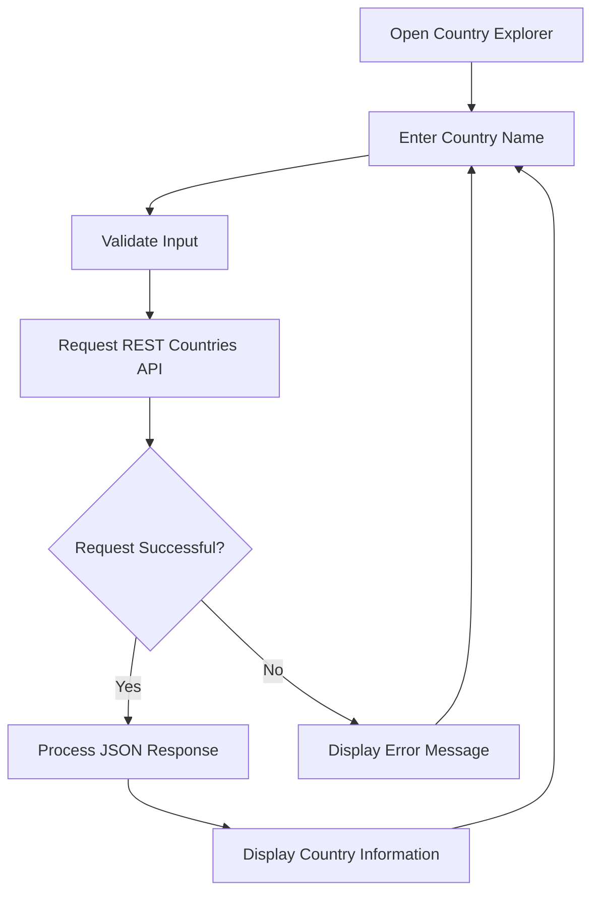

# Task: Create a Professional GitHub README.md for Country Explorer

Act as a senior technical writer, GitHub profile specialist, and open-source project documentation expert.

Create a complete, visually attractive, professional `README.md` for my **Country Explorer** project.

**Important: Only create the README.md file. Do not generate or modify index.html, styles.css, script.js, or any other project files.**

The README should make my GitHub repository look professional and clearly explain what the project does, how it works, what technologies it uses, and how users can run it.

---

## 1. Project Information

**Project Name:** Country Explorer

**Developer:** Yash Gunjal

**GitHub Username:** YashGunjal9

**Project Description:**

Country Explorer is a responsive web application that allows users to search for countries and explore their information using the REST Countries API.

Users can search for a country by name and view its flag, capital, population, currency, region, languages, ISO country code, and international dialing code.

**Technology Stack:**

* HTML5
* CSS3
* Bootstrap 5
* Vanilla JavaScript
* REST Countries API

**Repository URL:**

https://github.com/YashGunjal9/Country-Explorer

Use this repository URL only if it matches the actual repository for this project.

---

## 2. Existing Project Structure

The project contains the following files and folders:

```text
Country Explorer/
│
├── index.html
├── styles.css
├── script.js
├── README.md
│
└── Screenshots/
    ├── Country explored information.png
    └── Country explorer search bar.png
```

The two screenshots already exist.

**Preserve their filenames exactly. Do not rename, replace, or regenerate them.**

---

## 3. README Design and Formatting

Create a polished GitHub README using Markdown and GitHub-supported HTML.

Use a professional, modern style inspired by high-quality open-source repositories.

Include:

* Centered project title and subtitle.
* Relevant emojis.
* Technology badges.
* A short project description.
* Clearly separated sections.
* Attractive screenshot presentation.
* A workflow diagram.
* A technology table.
* Installation instructions.
* A feature list.
* A project structure section.
* Developer information.
* A license section.

Use a clean blue-and-purple visual identity inspired by the website's gradient background.

Keep the README informative without adding unnecessary text.

Do not use excessive emojis or irrelevant badges.

---

## 4. Header Section

Create a centered header using HTML supported by GitHub Markdown.

Include:

# 🌍 Country Explorer

**Discover information about countries around the world.**

Add a short description explaining that the application retrieves country information using the REST Countries API.

Add relevant badges for:

* HTML5
* CSS3
* Bootstrap 5
* JavaScript
* REST Countries API

Use Shields.io badges with appropriate colors and logos.

Keep the badges centered beneath the project description.

Do not include fabricated GitHub star counts, fork counts, download counts, test results, or deployment statuses.

---

## 5. Project Screenshots

Create a dedicated section titled:

## 🖥️ Project Screenshots

Display the two existing screenshots with appropriate headings and descriptions.

### Screenshot 1: Country Search Interface

Exact filename:

`Country explorer search bar.png`

Relative path:

`Screenshots/Country explorer search bar.png`

Use this Markdown image reference:

```markdown

```

Description:

This screenshot demonstrates the initial application interface, including the gradient background, Country Explorer heading, subtitle, country search field, and Search button.

### Screenshot 2: Country Information Display

Exact filename:

`Country explored information.png`

Relative path:

`Screenshots/Country explored information.png`

Use this Markdown image reference:

```markdown

```

Description:

This screenshot demonstrates the country information card displaying India's flag and information such as capital, population, currency, region, languages, ISO code, and international dialing code.

Place both screenshots prominently in the README.

Use descriptive alternative text for accessibility.

Do not change the filenames or paths.

Do not create fake screenshots.

---

## 6. About the Project

Create a section titled:

## 📖 About the Project

Explain that Country Explorer is a frontend web application designed to make country information accessible through a simple search interface.

Describe how users can enter a country name and retrieve information through the REST Countries API.

Mention that the application uses JavaScript to request API data and dynamically display the results.

Explain that the interface includes:

* A country search form.
* A country flag.
* A country information card.
* A responsive information grid.
* Loading and error messages, if implemented.

Do not claim features that are not supported by the actual project.

---

## 7. Features

Create a section titled:

## ✨ Features

Include relevant features such as:

* 🌍 Search for countries by name.
* 🏳️ Display country flags.
* 🏙️ Show capital city information.
* 👥 Display population.
* 💱 Show currency details.
* 🗺️ Display region information.
* 🗣️ Display available languages.
* 🔤 Show ISO country codes.
* 📞 Display international dialing codes.
* ⚡ Retrieve information through the REST Countries API.
* 📱 Responsive user interface.
* 🔄 Search for different countries without reloading the page.
* ⚠️ Handle invalid searches and API errors, if implemented.

Only describe features that actually work in the application.

---

## 8. How It Works

Create a section titled:

## ⚙️ How It Works

Explain the application's workflow in numbered steps:

1. The user opens the Country Explorer website.
2. The user enters a country name in the search field.
3. JavaScript validates the input.
4. The application sends an HTTP request to the REST Countries API.
5. The API returns country information in JSON format.
6. JavaScript processes the response.
7. The application displays the country's flag and information card.
8. The user can search for another country.

Explain that the displayed information comes from the API rather than hardcoded country data.

---

## 9. Workflow Diagram

Add a Mermaid flowchart supported by GitHub Markdown.

Use the following diagram:



Give the diagram an appropriate heading and explain briefly how data moves from the user interface to the API and back to the application.

---

## 10. Technologies Used

Create a professional Markdown table with the following columns:

| Technology         | Purpose                                             |
| ------------------ | --------------------------------------------------- |
| HTML5              | Structures the web application                      |
| CSS3               | Styles the interface and gradient background        |
| Bootstrap 5        | Provides responsive layout utilities and components |
| JavaScript         | Handles search, API requests, and dynamic rendering |
| REST Countries API | Supplies country information                        |

Keep the explanations concise and accurate.

---

## 11. API Information

Create a section titled:

## 🌐 API Reference

Explain that the application uses the REST Countries API.

API endpoint:

`https://restcountries.com/v3.1/name/{country}`

Example request:

`https://restcountries.com/v3.1/name/India`

Explain that the API provides country information in JSON format.

Include a link to the official API website:

https://restcountries.com/

Mention that API requests require an internet connection.

Do not claim that the API requires an API key for this endpoint.

---

## 12. Project Structure

Create a section titled:

## 📂 Project Structure

Display the following tree:

```text
Country Explorer/
│
├── index.html
├── styles.css
├── script.js
├── README.md
│
└── Screenshots/
    ├── Country explored information.png
    └── Country explorer search bar.png
```

Explain the purpose of each file:

* `index.html`: Main page structure.
* `styles.css`: Application styling and responsive design.
* `script.js`: Search functionality and API integration.
* `README.md`: Project documentation.
* `Screenshots/`: Reference screenshots of the application.

---

## 13. Installation and Usage

Create a section titled:

## 🚀 Getting Started

Explain how to run the project locally.

### Prerequisites

* A modern web browser.
* Internet access for API requests.
* Visual Studio Code, optionally.
* The Live Server extension, optionally.

### Installation

Provide these commands:

```bash
git clone https://github.com/YashGunjal9/Country-Explorer.git
```

```bash
cd Country-Explorer
```

If the repository has a different name, explain that the clone URL and folder name must match the actual repository.

### Running the Application

Explain that users can:

1. Open the project folder in Visual Studio Code.
2. Open `index.html` directly in a browser or launch it using Live Server.
3. Enter a country name.
4. Click Search or press Enter.
5. View the returned country information.

Do not introduce npm installation commands because this project does not require a Node.js build process.

---

## 14. GitHub Pages Deployment

Create a section titled:

## 🌐 Live Demo

Explain how to publish the static website using GitHub Pages.

Provide a link to the official GitHub Pages documentation:

https://docs.github.com/en/pages

Explain these steps:

1. Open the repository on GitHub.
2. Navigate to Settings.
3. Open Pages.
4. Select the `main` branch and root folder as the deployment source, if appropriate.
5. Save the settings.
6. Wait for GitHub Pages to publish the website.

Use a placeholder for the live website URL until deployment is confirmed.

Do not invent a working live-demo URL or claim that the website has already been deployed.

---

## 15. Future Improvements

Create a section titled:

## 🔮 Future Improvements

Suggest possible future enhancements:

* Country search suggestions.
* Recently searched countries.
* Country comparison.
* More detailed country information.
* Improved accessibility.
* Additional responsive design refinements.

Clearly identify these as potential improvements rather than existing features.

---

## 16. Developer Section

Create a section titled:

## 👨‍💻 Developer

Include:

**Yash Gunjal**

GitHub profile:

https://github.com/YashGunjal9

Use a clickable Markdown link to the GitHub profile.

Do not invent an email address, social media profile, or personal website.

---

## 17. License Section

Create a section titled:

## 📄 License

Do not claim that the project uses the MIT License or another license unless the repository contains the corresponding license file.

If no license file exists, state that licensing information has not yet been specified.

---

## 18. GitHub Repository Recommendations

At the end of the response, separately recommend the following repository description:

`A responsive Country Explorer built with HTML, CSS, Bootstrap, and JavaScript using the REST Countries API.`

Recommend these repository topics:

* `country-explorer`
* `rest-countries-api`
* `javascript`
* `html`
* `css`
* `bootstrap`
* `web-development`
* `country-information`

These recommendations should be separate from the README content so I can add them to the repository's About section manually.

---

## 19. Final Output Requirements

Produce the complete contents of **one file only: `README.md`**.

Requirements:

* Provide the entire README, not an outline.
* Use clean and valid Markdown.
* Use GitHub-compatible HTML only where helpful.
* Include all sections specified above.
* Include both screenshot references with the exact existing filenames.
* Preserve the spaces and capitalization in the screenshot paths.
* Ensure the Mermaid diagram uses valid syntax.
* Ensure all Markdown links and image references are correct.
* Do not create or modify website source files.
* Do not invent features, statistics, test results, deployment URLs, or license information.
* Do not repeat the prompt in the output.
* Do not omit any required section.

**The final result must be ready to paste directly into the existing `README.md` file in my GitHub repository.**
