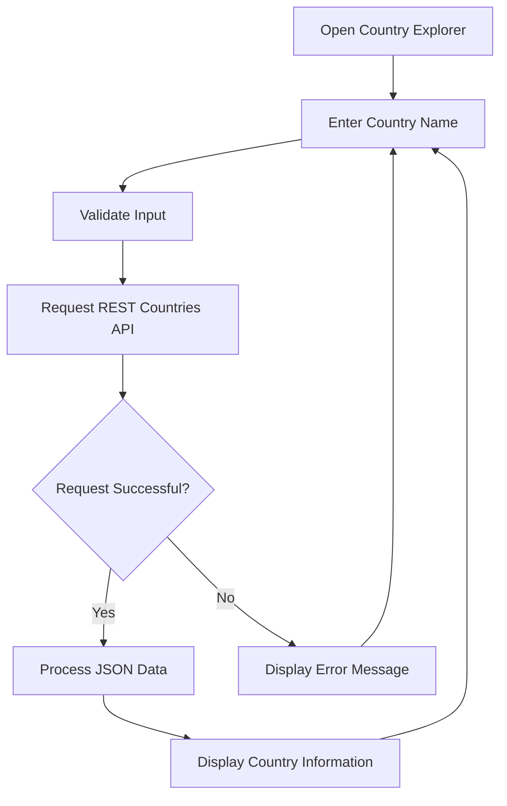

<div align="center">

# 🌍 Country Explorer

### Discover information about countries around the world.

A responsive web application that lets you explore country information using the REST Countries API.


</div>

---

## 📖 About the Project

**Country Explorer** is a web application designed to make country information easy to access.

Users can search for a country by name and view information retrieved from the REST Countries API.

The application features a clean interface with a blue-to-purple gradient background, a country search form, and a country information card.

## ✨ Features

* 🌍 Search for countries by name.
* 🏳️ Display country flags.
* 🏙️ View capital city information.
* 👥 Explore population data.
* 💱 View currency information.
* 🗺️ Discover the geographical region.
* 🗣️ View available languages.
* 🔤 Display ISO country codes.
* 📞 View international dialing codes.
* ⚡ Retrieve country information using an API.
* 📱 Responsive user interface.

*Features listed here should match the functionality implemented in the application.*

---

## 🖥️ Project Screenshots

### 🔍 Country Search Interface

The initial screen provides a simple search interface for entering a country name.


### 🌍 Country Information Display

After searching for a country, its flag and available information are displayed in a structured card.


---

## ⚙️ How It Works

1. **Enter a country:** Type a country name into the search field.
2. **Validate input:** JavaScript checks that the search field is not empty.
3. **Request data:** The application sends a request to the REST Countries API.
4. **Process the response:** JavaScript processes the returned JSON data.
5. **Display results:** The application displays the country's flag and available information.
6. **Search again:** Enter another country name to explore more countries.

### 🔄 Application Workflow



---

## 🛠️ Technologies Used

| Technology         | Purpose                                             |
| ------------------ | --------------------------------------------------- |
| HTML5              | Structures the web page                             |
| CSS3               | Provides styling, gradients, and responsive layouts |
| Bootstrap 5        | Supports responsive design and interface components |
| JavaScript         | Handles search functionality and API requests       |
| REST Countries API | Provides country information                        |

---

## 🌐 API Reference

This project uses the REST Countries API to retrieve country information.

**API endpoint:**

`https://restcountries.com/v3.1/name/{country}`

**Example:**

`https://restcountries.com/v3.1/name/India`

The API returns country information in JSON format.

Documentation: https://restcountries.com/

An internet connection is required to retrieve country information.

---

## 📂 Project Structure

```text
Country-Explorer/
│
├── index.html
├── styles.css
├── script.js
├── README.md
│
└── Screenshots/
    ├── Country explored information.png
    └── Country explorer search bar.png
```

### File Descriptions

* `index.html` — Main application structure.
* `styles.css` — Application styling and responsive layout.
* `script.js` — Country search functionality and API integration.
* `README.md` — Project documentation.
* `Screenshots/` — Application screenshots displayed in this README.

---

## 🚀 Getting Started

### Prerequisites

* A modern web browser.
* An internet connection.
* Visual Studio Code (optional).

### Installation

Clone the repository:

```bash
git clone https://github.com/YashGunjal9/Country-Explorer.git
```

Navigate to the project directory:

```bash
cd Country-Explorer
```

### Run the Application

1. Open the project folder in Visual Studio Code.
2. Open `index.html` directly in your browser or use the Live Server extension.
3. Enter a country name in the search field.
4. Click **Search** or press Enter.
5. Explore the returned country information.

---

## 🌍 Deployment

You can publish this static website using GitHub Pages.

1. Open your GitHub repository.
2. Navigate to **Settings → Pages**.
3. Select the `main` branch and root directory as the deployment source.
4. Save your settings.
5. Wait for the deployment to finish.

Documentation: https://docs.github.com/en/pages

**Live Demo:** Add your published website URL here after deployment.

---

## 🔮 Future Improvements

* Search suggestions and autocomplete.
* Recently searched countries.
* Country comparison functionality.
* Additional country information.
* Improved accessibility.
* Further mobile interface improvements.

---

## 👨‍💻 Developer

**Yash Gunjal**

GitHub: [@YashGunjal9](https://github.com/YashGunjal9)

---

## 📄 License

No license has been specified in this repository. Add a license file if you intend to distribute the project under a particular open-source license.

---

<div align="center">

**🌍 Explore the world, one country at a time!**

If you find this project useful, consider giving the repository a ⭐.

</div>
